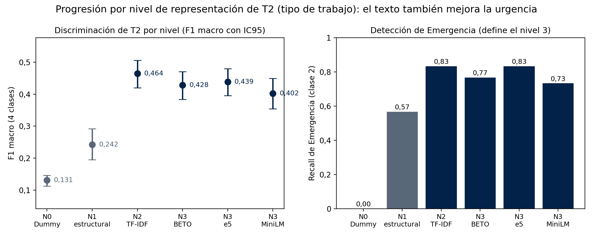
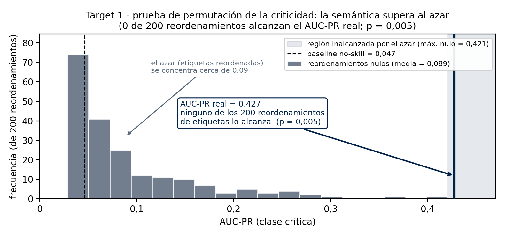
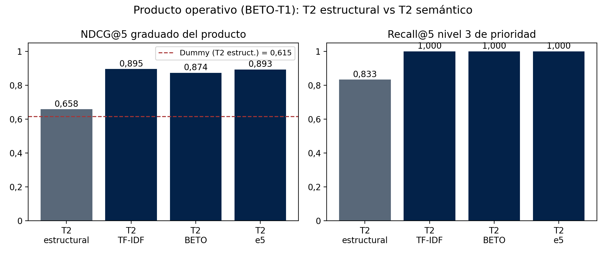
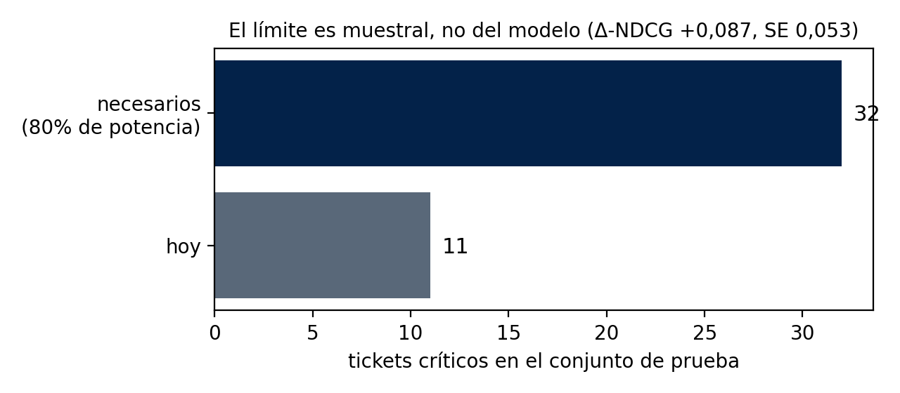

<div align="center">

# NOC Ticket Triage and Prioritization with Language Models
### A master's graduation project in Data Science at Pontificia Universidad Católica de Chile


</div>

This portfolio repository summarizes the research, methodology, and principal results of my second master's degree project, completed as part of the **Magíster en Ciencia de Datos** at the **Pontificia Universidad Católica de Chile (PUC Chile)**. The work was developed by a three-person team; authorship and the official thesis title are listed in the citation section.

The thesis studies whether information available when an incident ticket is opened can help a Network Operations Center (NOC) identify and prioritize critical events. It evaluates a text-based triage approach on 588 historical FTTH and DAS incident tickets recorded between 2023 and 2026.

> **Scope of this portfolio package:** an English-language research overview and aggregate result figures. Ticket-level data, raw records, embeddings, prediction arrays, and internal application material are not included.

## Research question

Can the ticket description available at intake (`t = 0`) support useful early prediction of incident **severity** and **work type**, and can those predictions improve a capacity-constrained operational ranking?

The work treats prioritization as two related classification tasks:

- **Target 1 — Severity:** Minor or Critical.
- **Target 2 — Work type:** Corrective, Preventive, Emergency, or Incident.

The two outputs form an ordinal priority level from 0 to 3. Level 3 represents a Critical Emergency and receives the highest operational priority. The ranking is evaluated over rolling seven-day windows with a capacity of `K = 5` tickets.

## Methodology

The evaluation was designed around the information genuinely available at ticket intake:

1. **Temporal evaluation:** records are ordered chronologically and divided into an approximately 60/40 train/test split, with a seven-day exclusion gap to reduce temporal leakage. The final test set contains 236 tickets.
2. **Target isolation:** post-resolution fields and strong target proxies are excluded from predictors. The models use intake-time text and eligible structural information only.
3. **Representation comparison:** a structural Random Forest control is compared with TF-IDF and contextual text representations, including BETO and multilingual encoders.
4. **Imbalance-aware assessment:** severity is evaluated with AUC-PR against the test prevalence baseline. Work type is evaluated with macro F1. The combined ranking uses graded NDCG@5 and Recall@5 for the highest-priority level.
5. **Uncertainty checks:** paired confidence intervals and permutation tests assess the text signal; the report also quantifies the sample size needed to confirm the ranking effect.

## Main results

| Evaluation | Result | Interpretation |
|---|---:|---|
| Severity, structural Random Forest | AUC-PR **0.071**; test prevalence **0.047** | The structural control is not significantly above the prevalence baseline. |
| Severity, BETO text representation | AUC-PR **0.427**; permutation **p = 0.005** | Intake description semantics discriminate critical incidents above the baseline. |
| Work type, structural vs. text | Macro F1 **0.242 → 0.464** | Text improves the four-class urgency/work-type task; the report gives non-overlapping confidence intervals. |
| Combined text-based ranking | NDCG@5 **0.874**; level-3 Recall@5 **1.0** | All highest-priority test events are retrieved within the operational top five. |
| Random-severity ranking baseline | NDCG@5 **0.771** | The full text-based product is higher in this test, though the isolated gain needs more evidence. |

### Severity and work-type signal

The representation comparison shows that the strongest evidence comes from ticket text available at intake, while the structural control has little predictive value for severity.

<div align="center">

</div>

The permutation analysis places the observed BETO severity result beyond the scores obtained after randomizing labels, supporting the conclusion that the intake text contains a real signal in this dataset.

<div align="center">

</div>

### Operational ranking and statistical limits

The full semantic product combines severity and work-type predictions in an ordinal ranking. Its observed NDCG@5 is **0.874**, compared with **0.771** for the random-severity baseline, and its level-3 Recall@5 is **1.0**. The estimated incremental NDCG is **+0.087**, with a 95% confidence interval of **[-0.015, +0.192]** and **p = 0.055**. Since the interval includes zero and the p-value is above 0.05, the thesis treats this ranking improvement as directional rather than statistically confirmed.

<div align="center">

</div>

Only **11 critical tickets** occur in the test set. Under the report's stated assumptions, approximately **32 critical test cases** would be needed for 80% power to confirm an effect of the observed size. This is an optimistic planning estimate, not a guarantee that a future study will reproduce the effect.

<div align="center">

</div>

## Interpretation and limitations

The main supported finding is that the semantic content of the initial ticket description predicts severity better than the available structural fields in this dataset. The combined ranking retrieves the observed high-priority events in the test set, but the incremental NDCG improvement has not been statistically confirmed because critical cases are scarce.

The model's probabilities should **not** be treated as reliable estimates of incident risk: the final report records a negative Brier Skill Score (**-0.269**). The intended use is relative queue ordering with human oversight, not automatic ticket closure, autonomous dispatch, or unreviewed operational action.

The generative runbook assistant is a separate experimental prototype. In the blinded review, it did not meet the minimum utility threshold for critical tickets (**2.92** against a required **3.00**); it is therefore not presented as a validated operational system. The study is an offline evaluation on one organization's historical data and does not establish generalization to other NOCs or networks.

## Repository contents

```text
repoThesis2/
├── README.md
└── assets/
    ├── fig_v3_escalera_t2.png
    ├── fig_v3_permutacion.png
    ├── fig_v3_producto_t2.png
    └── fig_v3_potencia.png
```

The figures are aggregate plots from the final thesis report. This portfolio summary does not contain source notebooks, company ticket records, row-level predictions, embeddings, or internal UI screenshots.

## Thesis citation

Ramírez Castillo, J. A., Condori Acarapi, O., & Segovia Razo, A. F. (2026). *Asistente de Operación de Red basado en Large Language Models para clasificación y priorización de tickets de incidentes en entornos de TI y Telecom* [Final Graduation Activity III report]. Magíster en Ciencia de Datos, Pontificia Universidad Católica de Chile, Santiago, Chile. Supervisor: Jean Fuentes.

## Acknowledgments

This work was completed collaboratively with **Jorge Armando Ramírez Castillo** and **Osman Condori Acarapi**, under the guidance of **Professor Jean Fuentes**.
